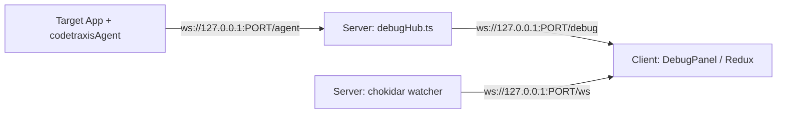

# AGENTS.md — Guidelines for Antigravity & AI Agents

This file provides context, architectural guidelines, development workflows, and coding conventions for AI agents operating in the **codetraxis** repository.

---

## 1. Project Overview

**codetraxis** is a local-first DevTools alternative for JavaScript, React, and React Native/Expo projects. It provides a browser-based UI (`http://localhost:3333` by default) with:
- **Live File Explorer**: Interactive file tree with `.gitignore` awareness and Git status indicators.
- **Monaco Editor / Preview**: Read-only syntax-highlighted code viewer and image/SVG previewer.
- **Network Inspector**: Intercepts `fetch`, `XMLHttpRequest`, and `axios` calls with headers, request/response bodies, durations, and status codes.
- **Console Timeline**: Real-time event timeline capturing `log`, `info`, `warn`, and `error` outputs.
- **TypeScript Interface Generator**: Generates TypeScript interfaces on the fly from network payloads.
- **Real-Time Watcher**: WebSocket-driven file system watcher via `chokidar`.

The tool operates strictly locally (bound to `127.0.0.1`) and injects a lightweight agent (`codetraxisAgent/`) into target projects.

---

## 2. Architecture & Monorepo Structure

```
codetraxis/
├── bin/
│   └── cli.js                  # CLI entry point (handles dev/prod modes, port finding, browser launch)
├── server/                     # Express & WebSocket backend (TypeScript)
│   ├── src/
│   │   ├── index.ts            # Main HTTP server, WebSocket server, static client serving
│   │   ├── routes/             # REST endpoints (/api/tree, /api/file, /api/agent)
│   │   └── utils/
│   │       ├── agent/          # agentInstaller.ts (code injection/removal), debugHub.ts (WS relay)
│   │       ├── watcher/        # watcherService.ts, gitignoreWatcher.ts
│   │       ├── file/           # buildTree.ts, gitignoreLoader.ts
│   │       └── git/            # getGitStatus.ts
│   └── dist/                   # Compiled backend (CommonJS, ES2020)
├── client/                     # React 19 + Vite frontend (TypeScript)
│   ├── src/
│   │   ├── pages/home/Home.tsx # Core layout (TopMenu, LeftMenu, FileViewer, DebugPanel)
│   │   ├── components/home/    # UI components (tree, modals, Monaco editor, timeline, etc.)
│   │   └── redux/              # Redux Toolkit store (treeSlice, fileSlice, debugSlice)
│   └── dist/                   # Static production bundle served by Express
├── codetraxisAgent/            # Agent template source (injected into target projects)
│   ├── shared.ts               # WebSocket connection to server (/agent)
│   └── interceptors/           # Interceptors for console, fetch, and XMLHttpRequest
└── codetraxisAgent-dist/       # Compiled agent template bundled with the npm package
```

### Key WebSocket Communication Flow



1. **Target App Agent** (`codetraxisAgent`): Connects to `ws://localhost:3333/agent` and streams captured console and network events.
2. **Server Relay** (`debugHub.ts`): Relays events to connected client viewers at `ws://localhost:3333/debug`.
3. **File Watcher** (`watcherService.ts`): Emits `tree_changed` and `file_changed` to `ws://localhost:3333/ws`.

---

## 3. Essential Commands

### Root Workspace Commands

```bash
npm install                    # Install root dependencies
npm run dev                    # Run client & server concurrently in development mode
npm run build                  # Build agent, server, and client bundles
npm run build:agent            # Compile codetraxisAgent/ -> codetraxisAgent-dist/
npm run build:server           # Compile server TS -> server/dist/
npm run build:client           # Build Vite client -> client/dist/
npm start                      # Start compiled server (serves client/dist)
npm run codetraxis             # Run CLI entry against current directory
```

### Testing CLI Locally

```bash
npm link                       # Create global symlink for codetraxis command
codetraxis /path/to/project    # Run codetraxis on any target project
```

### Server-Only (`cd server`)

```bash
npm run dev                    # Run with ts-node-dev (hot reload)
npm run build                  # Compile with tsc
npm run lint                   # Run ESLint
```

### Client-Only (`cd client`)

```bash
npm run dev                    # Vite dev server on port 5173 (proxies to :3333)
npm run build                  # tsc -b && vite build
npm run lint                   # Run ESLint
```

---

## 4. Key Implementation Details & Conventions

- **Safe Code Modification**: `agentInstaller.ts` uses `@babel/parser` to locate the top of the entry file (e.g. `index.tsx`, `App.tsx`, `main.tsx`) and inject `import "./codetraxisAgent"`, ensuring clean injection and idempotent removal.
- **Event Limits**: `debugSlice` caps stored events at 500 items, upserting by ID to prevent unbounded memory growth.
- **Port Resilience**: Uses `get-port` to fallback to an open port if `3333` is occupied.
- **Local Security**: Restricted to `127.0.0.1` by default to avoid exposing internal network activity.
- **Git & Ignore Filtering**: The file tree strictly honors `.gitignore` via the `ignore` package and live updates if `.gitignore` changes.
- **Monaco Editor**: Used in read-only mode to prevent accidental overwrites when inspecting target repositories.

---

## 5. Guidelines for Code Changes

1. **Keep Types in Sync**: Changes to event types in `codetraxisAgent/` must be mirrored in `client/src/components/home/debugPanel/utils/types.ts` and `client/src/redux/debugSlice/`.
2. **Build Validation**: Always verify builds across components after major changes (`npm run build` or targeted component builds).
3. **Preserve Compatibility**: Keep the agent injection footprint zero-dependency and compatible with diverse JavaScript/TypeScript bundlers (Vite, Webpack, Metro, etc.).
